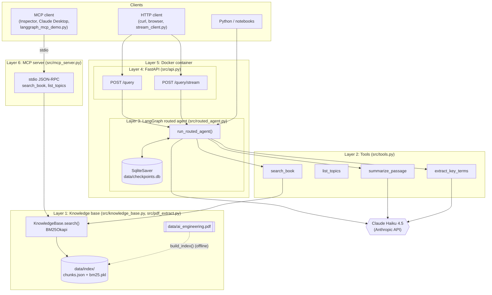
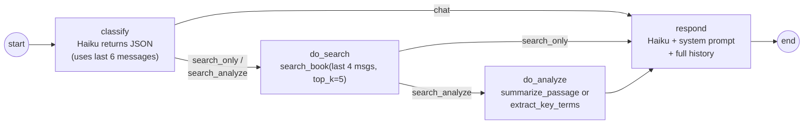
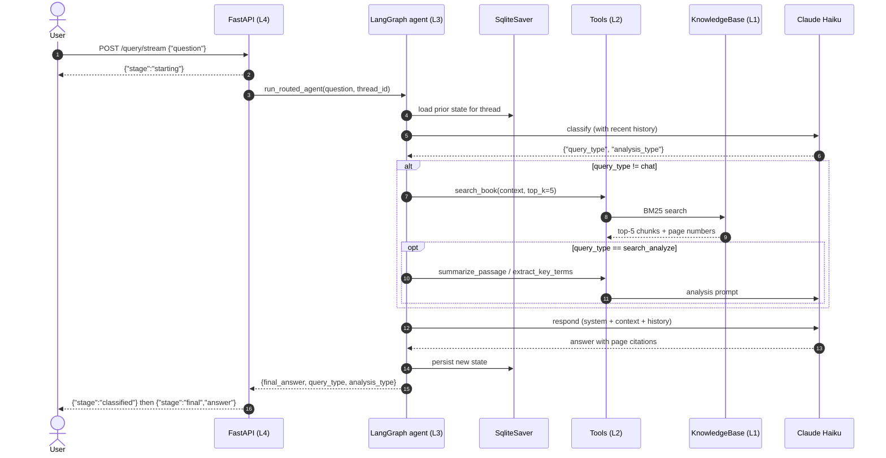

# Book Agent

A question-answering agent over the book *AI Engineering* (Chip Huyen). It takes a natural-language question, decides whether the question needs the book at all, searches the book with BM25, optionally summarizes or extracts key terms, and returns an answer grounded in the retrieved passages, with page citations.

The same retrieval tools are reachable three ways:

| Entry point | How | Who it's for |
|---|---|---|
| **Python** | `from src.routed_agent import run_routed_agent` | notebooks, scripts, tests |
| **HTTP API** | FastAPI: `POST /query`, `POST /query/stream` | web or mobile clients, `curl` |
| **MCP** | `python -m src.mcp_server` (stdio JSON-RPC) | Claude Desktop, MCP Inspector, other agents |

## Summary

1. **Index:** the PDF is extracted with PyMuPDF and split into **1,485 overlapping chunks** (1,000 characters, 150 overlap) from 527 non-blank pages. A BM25 index is built over them and saved to `data/index/`.
2. **Tools:** the index is wrapped in four LLM-callable tools with Anthropic JSON schemas: `search_book`, `list_topics`, `summarize_passage`, `extract_key_terms`.
3. **Agent:** a LangGraph `StateGraph` classifies each question (`chat`, `search_only` or `search_analyze`) and routes it through search, analysis and response nodes with conditional edges. Conversation state is checkpointed to SQLite per `thread_id`, so follow-up questions keep their context.
4. **Serving:** a FastAPI service exposes the agent over HTTP, including an NDJSON streaming endpoint. It is packaged as a multi-stage Docker image and run with Docker Compose.
5. **Interop:** an MCP server exposes `search_book` and `list_topics` over the Model Context Protocol. A LangGraph ReAct agent consumes those tools through `langchain-mcp-adapters`.

All LLM calls use **Claude Haiku 4.5** (`claude-haiku-4-5-20251001`).

---

## Architecture



The MCP path runs **alongside** the HTTP path, not after it. MCP clients bypass FastAPI and the routed agent and go straight to the knowledge base.

### Layer 1: Knowledge base
`src/pdf_extract.py`, `src/knowledge_base.py`

Retrieval infrastructure. No LLM involved.

- `extract_pdf()` reads the PDF with PyMuPDF (`fitz`) and returns `{page, text}` for each non-blank page.
- `chunk_pages()` slides a 1,000-character window with 150 characters of overlap across each page and drops fragments of 100 characters or fewer. Each chunk keeps its page number (`chunk_id = p{page}_c{n}`).
- `build_index()` tokenizes (lowercase, punctuation stripped), builds a `BM25Okapi` index, and saves `chunks.json` (readable) and `bm25.pkl` (fast to reload) to `data/index/`.
- `KnowledgeBase` loads the saved index. `.search(query, top_k=5)` returns the top-k chunks with their BM25 scores.

### Layer 2: Tools
`src/tools.py`

Wraps the knowledge base as LLM-callable functions. Each one pairs an Anthropic tool schema (name, description, JSON `input_schema`) with a Python implementation, so a model can decide when to call it and with which arguments.

| Tool | Does | Uses an LLM? |
|---|---|---|
| `search_book(query, top_k=5)` | BM25 search; returns passages tagged with page and score | No |
| `list_topics()` | Returns the book's 10 chapter titles (hard-coded from the table of contents) | No |
| `summarize_passage(text, focus="")` | 2 to 4 bullets of 20 words or fewer | Yes, Haiku |
| `extract_key_terms(text, max_terms=5)` | `TERM: definition` lines, grounded only in the passage | Yes, Haiku |

`get_kb()` loads the `KnowledgeBase` lazily, once per process. The routed agent and the MCP server both use it, so search behaves the same everywhere.

### Layer 3: Agent (LangGraph)
`src/routed_agent.py`

This is where the control flow lives. A `StateGraph` over `RoutedState`:

```python
messages:       Annotated[list, add]   # full conversation, appended each turn
query_type:     "chat" | "search_only" | "search_analyze"
analysis_type:  "summarize" | "extract_terms" | ""
search_results: str                     # retrieved or analyzed context
```



- **classify:** Claude Haiku (temperature 0) labels the latest message, using recent turns as context. If its JSON can't be parsed, the agent falls back to `search_only`.
- **do_search:** builds the BM25 query from the last 4 messages, so follow-ups like "what were those techniques?" still retrieve the right passages.
- **do_analyze:** runs only on the `search_analyze` route.
- **respond:** sends the system prompt, the retrieved context and the full message history to Haiku and asks it to cite page numbers.
- **Checkpointing:** the graph is compiled once at import time with `SqliteSaver` (`data/checkpoints.db`, `check_same_thread=False` for FastAPI's threadpool). The same `thread_id` continues a conversation; a new one starts fresh.
- `build_routed_graph(checkpointer, interrupt_before)` also supports human-in-the-loop pauses (see `src/hitl_demo.py`).

### Layer 4: API (FastAPI)
`src/api.py`

The front counter: how outside clients talk to the agent over HTTP.

| Method | Path | Returns |
|---|---|---|
| `GET` | `/` | Health check `{"status": "ok"}` |
| `POST` | `/query` | `{final_answer, query_type, analysis_type}` (Pydantic `QueryResponse`) |
| `POST` | `/query/stream` | NDJSON lines: `starting` → `classified` → `final` |

Request body: `{"question": "..."}` (1 to 1,000 characters). Interactive docs are at `/docs`.

### Layer 5: Container (Docker)
`Dockerfile`, `docker-compose.yml`, `.dockerignore`

The food truck: the whole kitchen packaged to run the same anywhere.

- **Multi-stage build:** the builder stage installs dependencies with `uv sync --frozen --no-dev`. The runtime stage copies only `.venv`, `src/` and `data/` onto `python:3.11-slim`. Dropping uv and the pip cache shrank the image from 918 MB to 804 MB.
- **Secrets** are injected at runtime from `.env` and never baked into the image (`.env` is listed in `.dockerignore`).
- `.dockerignore` must keep `README.md`, because `pyproject.toml` references it and `uv sync` fails without it.
- Compose builds `book-agent:v0.2`, maps port `8000:8000`, and restarts with `unless-stopped`.

### Layer 6: MCP server
`src/mcp_server.py`, `src/langgraph_mcp_demo.py`, `mcp.json`

The USB-C port: any MCP client can discover and call the tools without custom integration code.

- Built on the MCP Python SDK's low-level `Server` API (SDK pinned to `mcp>=1.28,<2`). It speaks JSON-RPC over stdio as a subprocess.
- It exposes `search_book` and `list_topics`, both backed by the same `get_kb()` as Layer 2.
- `langgraph_mcp_demo.py` starts the server through `MultiServerMCPClient`, loads its tools as LangChain tools, and runs a ReAct agent over them.

See [README_MCP.md](README_MCP.md) for details.

---

## Request flow



---

## Working environment

| Component | Version / note |
|---|---|
| OS | Developed on Windows 11 (PowerShell); the container runs Linux |
| Python | 3.11 (`.python-version`; tested with 3.11.15) |
| Package manager | [uv](https://docs.astral.sh/uv/) 0.11 (`pyproject.toml` + `uv.lock`) |
| LLM | Anthropic Claude Haiku 4.5 (`ANTHROPIC_API_KEY` required) |
| Key libraries | `anthropic`, `langgraph`, `langgraph-checkpoint-sqlite`, `langchain-anthropic`, `fastapi`, `uvicorn`, `pymupdf`, `rank-bm25`, `mcp[cli]` (1.x), `langchain-mcp-adapters` (0.1.x) |
| Optional | Docker Desktop (container); Node.js LTS (MCP Inspector) |

### Setup

```powershell
git clone https://github.com/<your-username>/book_agent.git
cd book_agent
uv sync
.\.venv\Scripts\Activate.ps1          # macOS/Linux: source .venv/bin/activate
```

Create a `.env` in the project root. It is git-ignored, so never commit it:

```
ANTHROPIC_API_KEY=sk-ant-...
```

Build the index. You only need this if `data/index/` is missing; it requires your own copy of the PDF at `data/ai_engineering.pdf`:

```powershell
python -m src.knowledge_base
```

### Run

```powershell
# Python
python -c "from src.routed_agent import run_routed_agent as r; print(r('What is RAG?')['final_answer'])"

# HTTP API: terminal 1
uvicorn src.api:app --reload
# terminal 2
curl -X POST http://127.0.0.1:8000/query -H "Content-Type: application/json" -d '{\"question\": \"What is RAG?\"}'
python -m src.test_stream              # streaming client

# Docker
docker compose up --build              # http://localhost:8000/docs

# MCP
python -m src.mcp_server               # standalone stdio server
npx @modelcontextprotocol/inspector .venv\Scripts\python.exe -m src.mcp_server
python -m src.langgraph_mcp_demo       # LangGraph agent consuming the MCP tools
```

---

## Repository structure

```
book_agent/
├── src/
│   ├── pdf_extract.py          # L1: PyMuPDF extraction + sliding-window chunking
│   ├── knowledge_base.py       # L1: BM25 index build/load, KnowledgeBase.search()
│   ├── tools.py                # L2: 4 tools + Anthropic schemas, get_kb()
│   ├── routed_agent.py         # L3: LangGraph routed agent + SqliteSaver   ← production path
│   ├── api.py                  # L4: FastAPI app (/query, /query/stream)
│   ├── mcp_server.py           # L6: MCP stdio server (search_book, list_topics)
│   ├── langgraph_mcp_demo.py   # L6: ReAct agent consuming the MCP server
│   │
│   ├── agent.py                # Earlier version: raw Anthropic SDK tool-use loop
│   ├── langgraph_agent.py      # Earlier version: same agent rebuilt in LangGraph
│   ├── checkpoint_demo.py      # Demo: multi-turn memory by thread_id
│   ├── hitl_demo.py            # Demo: human-in-the-loop interrupt/resume
│   ├── subgraph_demo.py        # Demo: research workflow as a subgraph
│   ├── inspect_checkpoints.py  # Utility: inspect checkpoints.db tables/threads
│   ├── stream_client.py        # Client: prints /query/stream output
│   └── test_stream.py          # Client: prints /query/stream stages
│
├── data/
│   ├── ai_engineering.pdf      # Source book (not committed; bring your own copy)
│   ├── index/
│   │   ├── chunks.json         # 1,485 chunks with page metadata
│   │   └── bm25.pkl            # Pickled BM25Okapi index
│   ├── checkpoints.db          # LangGraph SQLite checkpoints (created at runtime)
│   ├── test_set.json           # 6-question eval set (expected tool + topics)
│   ├── week3_agent_comparison.csv   # Raw SDK vs LangGraph: tool choice comparison
│   └── week4_day2_streaming.md      # Notes on the streaming endpoint
│
├── notebooks/                  # Learning log, in build order
│   ├── day1_pydantic_basics.ipynb
│   ├── day2_weather_agent.ipynb
│   ├── day3_sanity_check.ipynb
│   ├── day4_agent.ipynb
│   ├── day5_evaluation.ipynb
│   ├── week3_day1_sequential.ipynb
│   ├── week3_day3_langgraph.ipynb
│   ├── week3_day4_comparison.ipynb
│   ├── week3_day5_routed_agent.ipynb
│   └── setting.ipynb
│
├── Dockerfile                  # L5: multi-stage build (uv builder → slim runtime)
├── docker-compose.yml          # L5: one-command run with .env injection
├── .dockerignore
├── mcp.json                    # MCP client config pointing at src.mcp_server
├── pyproject.toml / uv.lock    # Dependencies (uv)
├── .python-version             # 3.11
├── main.py                     # Placeholder entry point
├── README.md                   # This file
├── README_MCP.md               # MCP integration details
├── README_dockerbasic.md       # Docker notes
└── README_multiagent.md
```

---

## Known limitations

- **API conversations share one thread.** `/query` and `/query/stream` don't accept a `thread_id`, so every HTTP request uses `thread_id="default"` and all callers share one conversation history. Multi-turn isolation currently works only from Python (`run_routed_agent(q, thread_id=...)`).
- **Streaming reports stages, not tokens.** `/query/stream` runs the whole graph before it emits `classified` and `final`, so only `starting` arrives early.
- **MCP `list_topics` differs from Layer 2.** `KnowledgeBase` has no `list_topics` method, so the MCP server falls back to a fixed 4-item list instead of the 10 chapters in `tools.list_topics()`.
- **Container runs as root.** The non-root `USER` lines in the `Dockerfile` are commented out.
- **Lexical retrieval only.** BM25 has no semantic embeddings or reranker, and chunks never span page boundaries.
- **Hard-coded Windows path.** `src/langgraph_mcp_demo.py` and `mcp.json` point at a Windows path to `.venv\Scripts\python.exe`; edit them for your machine.
